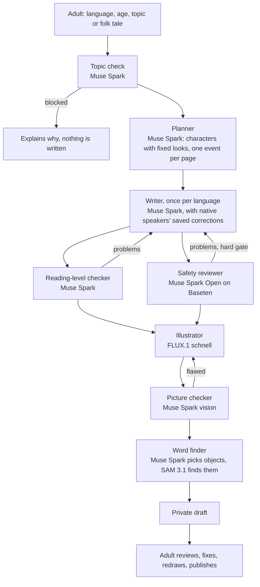

# MotherTongue Books

Original, illustrated children's picture books written natively in a child's own language, starting with **Telugu, Kannada and Marathi**.

**Live:** https://mothertongue-books.vercel.app

Children learn to read best in their mother tongue, but most of the world's languages have very few children's books. UNESCO estimates that around 40% of people worldwide don't have access to education in a language they understand. In India, a child in Belagavi or Guntur finds shelves of English picture books and very few in the language spoken at home.

MotherTongue Books lets a parent or teacher describe a story (or pick a folk tale), and a team of AI agents plans it, writes it **first in the language itself, not translated from English**, checks it for reading level and child safety, illustrates it and makes the pictures tappable for word learning. A person who speaks the language reviews every book before it is published.

Built during the Meta Global AI Developer Hackathon (Oct 27 – Nov 4, 2026), Indie Dev track. All code in this repository was written during the hackathon.

## What it does

- **Original books in Telugu, Kannada and Marathi**, at three reading levels (ages 3–5, 5–7, 7–9), and new in **Swahili, Nepali, isiZulu, Haitian Creole and Basque** (create-only until native speakers have checked them).
- **Two-language books**: the same story side by side, page by page (any two of Telugu, Kannada, Marathi and English).
- **Retold folk tales**: Muse Spark writes down how a traditional tale goes, softened for young children, and says so when it doesn't know a tale instead of inventing one. The adult edits the steps before the book is made.
- **Pictures** for every page, with a consistent look for each character, checked by a vision model and redrawn when flawed.
- **Tap to learn**: tap the cow, the bus or the kite in a picture to see and hear its word. Muse Spark picks the objects and names them in each language; **SAM 3.1** finds where each one is.
- **Native speakers stay in charge**: drafts are private; the adult reviews every page, fixes wording, redraws any picture, and only then publishes. "Fix a word" corrects the word everywhere in the book and teaches the writer, so later books get it right.
- **Save as PDF** for printing, ending with a "Words in this book" page.
- **Reading themes** (Paper, Warm, Night for bedtime) and the **website itself in Kannada, Telugu, Marathi or English**.

## How a book is made



Every step is shown live on the progress screen with the model that runs it.

- **The plan is language-neutral.** Every language version of a two-language book is written natively from the same plan, so neither is a translation of the other.
- **Safety is checked by a different model from the one that writes.** The safety reviewer (Muse Spark Open) is a hard gate: a story that still fails after two rewrites is not saved. The reading-level check is advisory; its remaining notes go to the adult.
- **Reasons before verdicts.** Every checker lists the problems it found before it decides, and its verdict must agree with them.
- **Pictures never contain names or text.** Character names are replaced with their fixed looks before the picture prompt, because image models tend to write any name they see.

## Models

| Step | Model | Where |
| --- | --- | --- |
| Topic check, planner, writer, reading level | Muse Spark (`muse-spark-1.3`) | Meta Model API |
| Folk-tale steps, word finder, picture checker (vision) | Muse Spark | Meta Model API |
| Safety reviewer | Muse Spark Open (`muse-spark-open-1026`) | Baseten |
| Object locations for tap-to-learn | SAM 3.1 | Meta Model API |
| Illustrations | FLUX.1 [schnell] | Cloudflare Workers AI (free plan) |

Muse Image wasn't available in our region, so pictures use FLUX.1 schnell; the picture checker is still Muse Spark.

## What it costs

Measured from the `model_usage` table, which records every call:

| | Cost |
| --- | --- |
| One illustrated 8-page book (story, checks, pictures, picture checks, tap words) | about $0.25 |
| Of which: picture checks | about $0.003 each |
| Of which: SAM 3.1 boxes | $0.0025 per object |
| Folk-tale steps | about $0.005 |
| Drafting the website's three translations | $0.17, once |

Spending is capped: a daily budget, a lifetime budget per provider, and hard `max_tokens` limits per call. The free illustrator draws about 70 pictures a day, so about six books a day.

## Stack

- **Frontend:** React 19, TypeScript, Vite, Tailwind CSS v4, on Vercel.
- **Backend:** Python 3.12, FastAPI, on Modal.
- **Data:** Supabase (Postgres with row-level security, Auth, Storage). Pictures are stored as WebP.

## Run it locally

Without any keys the backend runs in practice mode, with sample text instead of model calls.

```bash
cd backend
uv sync
uv run uvicorn app.main:app --reload --port 8000
```

```bash
cd frontend
npm install
npm run dev
```

For real models, copy `backend/.env.example` to `backend/.env`, set `USE_MOCK_AI=false` and fill in the keys it lists. Tests: `cd backend && uv run pytest`.

Useful scripts (from `backend/`):

- `uv run python -m scripts.redraw_pictures <book-id>`: redraw a book's pictures and tap words.
- `uv run python -m scripts.translate_ui`: draft website text for any phrases a language is missing.
- `uv run python -m scripts.starter_library make`: make the starter library within the day's free pictures.

## Adding a language

A language is one entry in each of two lists; a test fails if they ever disagree.

1. Add it to `backend/app/languages.py`: code, English name, the region its children live in (stories and pictures are set there), folk-tale traditions, and `reviewed=False`.
2. Add the same code to `frontend/src/lib/languages.ts`: its own-script name, a letter for the cover, one colour (pale and dark-theme versions are worked out from it), a story font, and the phone voice tag. If the script needs a font that isn't loaded, add it to the Google Fonts link in `frontend/index.html`.
3. Add `'lang.<code>'` to `frontend/src/locales/en.ts`, then run `uv run python -m scripts.translate_ui` from `backend/` to name it in the other website languages.
4. Run the tests. Set `reviewed` to true once native speakers have checked books in it; until then the site marks it "New".

The database only checks that a language code looks like one, so no migration is needed. Requests from visitors ("Ask for your language") are in the `language_requests` table.

## Repository layout

```
backend/app/agents/   the agents, their prompts and schemas, and the model clients
backend/app/          pipeline, pictures, tap-to-learn, storage, API
backend/tests/        pytest suite
frontend/src/pages/   library, create, progress, reader, review, PDF
frontend/src/locales/ website text in English, Telugu, Kannada and Marathi
supabase/migrations/  database schema
```

## Limits

- Pictures sometimes come out wrong (a twisted pose, an extra animal). The checker catches most; the adult can redraw any page.
- The website translations were drafted by Muse Spark and are being checked by native speakers.
- Read-aloud uses the phone's own voice for tap words; full narration isn't built.
- Children's voices are never recorded.

## License

Code: MIT. Published books: CC BY 4.0.
